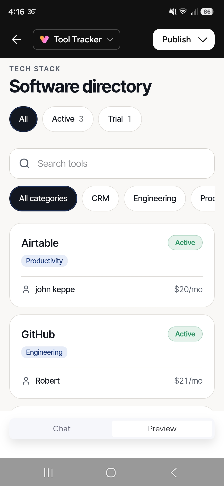

# Mobile Software Directory & Tech Stack Tracker 📱

> **Platform:** monday.com Work OS (Vibe App Framework)  
> **Connected Board:** Tool Tracker  
> **Status:** Prototyped & Functional (Unpublished due to workspace plan tier)

---

## 🌟 Overview
The **Mobile Software Directory** is a touch-friendly, responsive mobile application built using the **monday.com Vibe** framework. Designed to solve internal software sprawl and eliminate visibility bottlenecks, it empowers team members to browse company software, identify departmental tool owners, monitor monthly recurring costs, and verify subscription statuses in seconds.

---

## ✨ Key Capabilities
* **Real-Time Search:** A sticky search bar at the top of the screen allows users to instantly filter through every software tool by name while scrolling.
* **Dynamic Category Filtering:** Horizontally scrollable category filter chips (e.g., *CRM*, *Engineering*, *Productivity*) are dynamically derived server-side from all categories present on the underlying monday.com board—not just the items currently loaded on screen.
* **Glanceable Status Indicators:** Quick-filter pills at the top show live counts (e.g., *All*, *Active*, *Trial*), while individual item cards display color-coded status pills:
  * 🟢 **Green:** Active
  * 🟡 **Yellow:** Trial
  * 🟠 **Orange:** Under Review
  * 🔴 **Red:** Cancelled
* **Ownership & Spend Transparency:** Each tool card cleanly displays the software name, category tag, assigned departmental owner (defaulting to *"Unassigned"* if blank), and monthly subscription cost (e.g., `$20/mo`).
* **Paginated Loading:** Built-in pagination ("Load more") fetches the next 25 tools on demand to keep mobile performance fast and lightweight.

---

## 🏗️ Architecture & Data Schema
This application pulls live relational data directly from a backing monday.com board (**Tool Tracker**) structured with the following schema:

| Field / Column | monday.com Column Type | Purpose |
| :--- | :--- | :--- |
| **Tool Name** | Item Name | Name of the software application (e.g., *Airtable*, *GitHub*) |
| **Status** | Status | Subscription lifecycle state (*Active*, *Trial*, *Under Review*, *Cancelled*) |
| **Category** | Text / Dropdown | Departmental or functional classification (*Productivity*, *Engineering*, *CRM*) |
| **Owner** | People | Departmental lead or admin responsible for the license |
| **Monthly Cost** | Numbers | Recurring monthly subscription spend (`$/mo`) |

---

## 🎨 UI/UX Design Principles
* **Mobile-First Layout:** Single-column card architecture built specifically for thumb-friendly mobile navigation.
* **High Accessibility:** Crisp typography with high-contrast text, generous row padding, and clear visual hierarchy so critical metadata can be scanned at a glance.

---

## 💡 Operational Value
Unmanaged SaaS subscriptions lead to duplicate spending, shadow IT, and unclear accountability during employee onboarding or offboarding. By layering a custom mobile directory over a centralized monday.com tracker, operations and IT teams give employees self-service visibility into the company tech stack without exposing the underlying master database to accidental edits.
